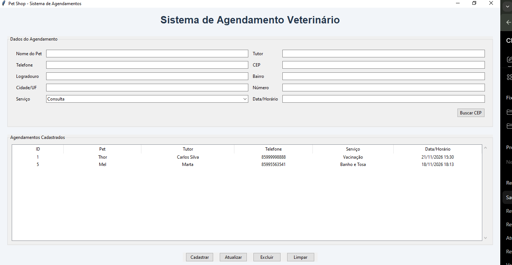

# 🐾 Sistema de Agendamento Pet Shop

Projeto acadêmico desenvolvido em Python para gerenciamento
de agendamentos de serviços em um Pet Shop.

## Tecnologias utilizadas

- Python
- Tkinter
- SQLite
- API ViaCEP
- Git e GitHub

## Funcionalidades

- Cadastro de agendamentos
- Consulta de agendamentos
- Atualização de informações
- Exclusão de agendamentos
- Integração com ViaCEP
- Registro de logs
- Testes de funcionalidades

## Estrutura do projeto

- main.py: aplicação principal
- banco.py: operações com banco de dados
- auditoria.py: registro de logs
- teste_banco.py: testes do banco de dados
- teste_auditoria.py: testes de auditoria

## Como executar

1. Instale o Python 3.
2. Baixe ou clone este repositório.
3. Abra a pasta no VS Code.
4. Execute:

```bash
python main.py
```

## Objetivo

Aplicar conhecimentos de desenvolvimento de aplicações
em Python, persistência de dados, integração com APIs
e testes de software.

## Autor

Léo Roseno

Projeto desenvolvido para fins acadêmicos e de portfólio.

## Interface do Sistema

A aplicação possui interface gráfica desenvolvida
com Tkinter, permitindo gerenciar os agendamentos
de forma prática.



## Testes e Validação

O projeto passou por testes funcionais para
verificar o comportamento das principais operações
do sistema.

### Funcionalidades verificadas

- Cadastro de agendamentos
- Consulta dos registros cadastrados
- Atualização de agendamentos
- Exclusão de registros
- Integração com a API ViaCEP
- Preenchimento automático de endereço
- Tratamento de CEP inválido
- Registro de operações em logs

### Testes do banco de dados

O sistema utiliza SQLite para armazenar os
agendamentos.

O arquivo `teste_banco.py` contém testes
relacionados às operações com o banco de dados.

### Testes de auditoria

O arquivo `teste_auditoria.py` é utilizado
para verificar o registro de operações
realizadas pelo sistema.


## Integração com a API ViaCEP

O sistema possui integração com a API pública
ViaCEP para consultar informações de endereço
a partir do CEP informado pelo usuário.

### Funcionamento

1. O usuário informa o CEP.
2. O sistema consulta a API ViaCEP.
3. Os dados do endereço são recebidos.
4. Os campos correspondentes são preenchidos
   automaticamente na interface.

### Tratamento de erros

A aplicação também possui verificações para
situações como:

- CEP inválido
- CEP não encontrado
- Falha na consulta à API

Essa integração permite reduzir o preenchimento
manual e melhorar a experiência do usuário.

API utilizada:
https://viacep.com.br/

